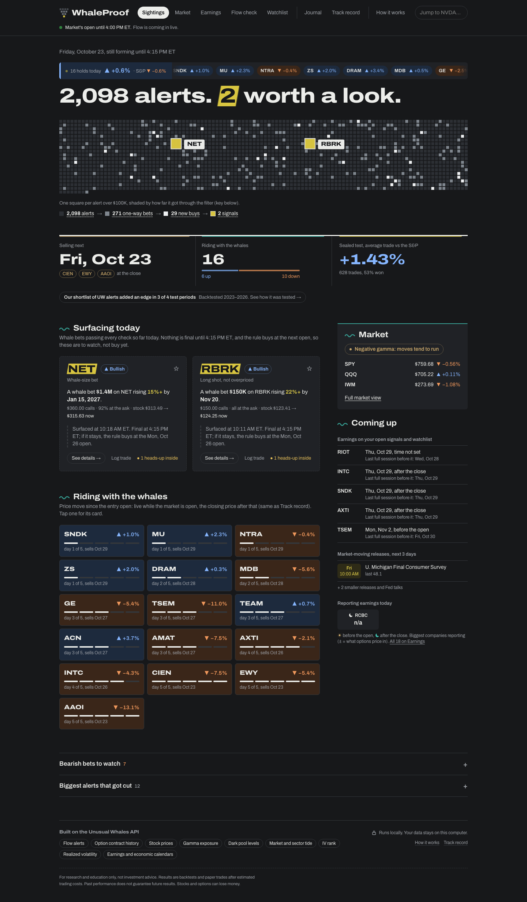

# WhaleProof

[](https://github.com/chantabbai/whaleproof-uw/actions/workflows/ci.yml)

**UW shows what whales do. WhaleProof shows which whale bets paid off.**

_Built in a private repo and copied here in one commit. The rules were frozen on Sep 30, 2026 and both sealed tests were run once; the records are in `journal/`._

**▶ [Watch the 2-minute demo](https://youtu.be/78hHvDNMBOw)**

[Did it work?](#did-it-work) · [How I tested it](#how-i-tested-it) · [Why the stock](#why-the-stock-and-not-the-option) ·
[The dashboard](#whats-on-the-dashboard) · [Ask an AI](#ask-an-ai-assistant-about-it) · [UW data used](#what-it-uses-from-unusual-whales) ·
[Run it yourself](#run-it-yourself) · [More reading](#more-reading) · [Data and keys](#data-and-keys)

If you watch Unusual Whales flow, you know the feed is great but it's a firehose. On a normal day UW
flags close to 4,000 trades over $100K, and most of them aren't bets at all. They're hedges, people closing positions,
or one leg of a spread. And nothing tells you whether following a given kind of alert would have made you money.

So I built WhaleProof. Its dashboard throws out the noise and keeps the few real one-way bets, about four
a day. For each one it tells you in plain English why it made the cut. Then it keeps score: every signal is bought at
the next morning's open, sold five trading days later, and compared with the S&P 500. I tested the rules on three years
of UW data and locked them before the sealed test was opened.



## Did it work?

Yes in both sealed tests; no in the recent months. In the sealed test the signals beat the S&P 500 by 1.43% a trade over
five days, after costs, across 628 trades. Following every one-way UW alert over the same months would have trailed the
S&P 500 by 0.03%.

| Period | Every one-way UW alert | WhaleProof signals | Signals that beat the S&P 500 | Trades |
|---|---|---|---|---|
| Oct 2023 – Sep 2024, the second sealed test, opened once | −0.07% | +1.74% | 52% | 233 |
| Oct 2024 – Sep 2025, the practice year, where I chose the rules | −0.09% | +1.22% | 54% | 488 |
| Oct 2025 – May 2026, the sealed test, opened once | −0.03% | +1.43% | 53% | 628 |
| Jun – Sep 2026, recent months I'd already seen | −0.15% | −1.55% | 41% | 334 |

Each number is the stock's average five-day move in the signal's direction, minus the S&P 500, after 0.10% costs.

The cuts held up too. In the practice year and both sealed tests, the alerts the filter throws out did worse than the
ones it keeps: put buys made −0.16% to −0.68% a trade, and alerts with earnings inside the five days made −0.24% to
−0.77% ([what the record shows](docs/METHODOLOGY.md#what-the-record-shows)).

The limits: from June to September 2026 the signals trailed the S&P 500 by 1.55% a trade, and the live record since Sep 30
is behind so far (3 weeks, about 4% a trade, [forward record](docs/FORWARD-RECORD.md)); signal stocks swing about 2.4× the
market, which leaves about 0.6% a trade in the sealed test ([beta check](docs/BETA-CHECK.md)). Promising, not proven: I use
the signals as a shortlist to research, not as trade calls.

## How I tested it

I started with every clean opening buy, meaning at least 70% bought at the ask, a single leg, a new position, a strike
no more than 30% out of the money and 7 to 90 days to expiry. On its own that made nothing. In the practice year I tried a lot of ideas on top of it: sweeps,
repeat buyers, dark-pool buying, sector flow, a 12-part score, and 687 combinations of simple rules. Two held up. One
is whale-size bets, $1M or more on a call more than 5% out of the money. The other is long shots at a fair price,
calls more than 15% out of the money where the option isn't expensive (IV rank under 70). Put buys and anything with earnings inside the
five days are left out.

Then I froze the rules and opened the two sealed tests once each. The code won't run them a second time. Every
decision only uses what was known that day, and the dashboard runs the same code as the backtest, so what you see
live is what was tested.

The details, every threshold and everything that didn't work are in [METHODOLOGY.md](docs/METHODOLOGY.md).

## Why the stock and not the option?

I tested that too, on real option prices. Copying the whale's option lost about 23% on a typical trade in five days.
The edge on the stock is only a percent or two a week, and the spread plus time decay on a
short-dated, out-of-the-money option eat that many times over. Taking profit at +20% wins more often but still loses on average, and most whale options (58–75%)
expire worthless anyway. So WhaleProof treats the flow as a tip about the stock, not a trade to copy.
[Full study](docs/STOCK-VS-OPTIONS.md).

## What's on the dashboard

- **Sightings** is the home page. You see the day's alerts as a grid with the signals lit up, each new signal with the
  reasons it passed and when to buy and sell, the signals still in their five-day hold, earnings and economic releases
  coming up, and the biggest alerts that got cut and why.
- **Market** shows dealer gamma, which way options money is leaning through the day and by sector, short-dated
  buying, and the gamma walls and dark-pool levels on SPY, QQQ and IWM.
- **Earnings** compares each report's implied move with how much the stock has really moved on past reports. Over
  28,000 reports, the stock beat the implied move only 34% of the time.
- **Flow check** lists every one-way bet UW flagged today with the filter's verdict. If you saw a trade on UW, type in the
  ticker, strike and expiry and it tells you whether it would count.
- **Ticker pages** put one stock on one screen: levels, 30 days of big-money flow, today's verdict, earnings and every
  past signal with how it did.
- **Track record** has every signal since October 2023 plus the live ones, and what the whale's own option did instead.
- **Watchlist** and **Journal** are for your names and your paper trades.
- **How it works** walks through the method in plain English, with a technical version for anyone checking the math.

## Ask an AI assistant about it

WhaleProof comes with an MCP server, so you can ask any MCP app (Claude Desktop, Claude Code, Cursor, VS Code…) the
same questions and get the dashboard's numbers back. It only reads your local cache, so it doesn't spend UW calls.

Add this server entry to your MCP app's config (for Claude Desktop that's `claude_desktop_config.json`):

```json
{ "mcpServers": { "whaleproof": { "command": "uv",
    "args": ["run", "--directory", "<repo>/backend", "whaleproof", "mcp"] } } }
```

There are six tools. Things you can ask:

- "What passed the filter today, and why?" (`desk_signals`)
- "Show me everything on NVDA." (`desk_ticker`)
- "I saw a $340 SNOW call on UW. Would the filter take it?" (`desk_lookup`)
- "Has this filter actually paid?" (`desk_evidence`)
- "How are the signals doing?" (`desk_tracker`)
- "Who reports earnings this week, and is the move priced cheap?" (`desk_earnings`)

Here's what an answer looks like (from Sep 30, shortened and reworded):

```text
> What passed WhaleProof's filter today, and why?

3,366 alerts → 433 one-way → 91 clean buys → 7 signals
  CRWV  $1.6M on the $107 call, Oct 23 expiry, 20% out of the money, sweep
        why: opening buy at the ask · option cheap · 4 other clean buys in 3 sessions
             · no earnings before the planned exit · 4 tech names flagged the same day
        what to do: buy CRWV stock at the Oct 1 open, sell at the Oct 7 close
  also: BA, GOOG, PH, PATH, ZETA, CAMT
```

## What it uses from Unusual Whales

Flow alerts, option contract history, stock prices, gamma exposure, dark-pool levels, market and sector tide, IV rank,
realized volatility, and the earnings and economic calendars. Everything on screen comes from real UW data. Nothing is
mocked. All calls go through one client that watches the daily budget and caches the results, so past days are only
fetched once.

## Run it yourself

Works on macOS, Linux and Windows. On every system you need:

- **git** ([git-scm.com](https://git-scm.com/downloads)) and **Node 20 or newer** with npm
  ([nodejs.org](https://nodejs.org/); `node -v` to check).
- **uv**, which brings its own Python (install line below, or [other ways](https://docs.astral.sh/uv/getting-started/installation/)).
- **An Unusual Whales API key** for live data, from [your UW API page](https://unusualwhales.com/dashboard/api).

Open a new terminal after installing, so the tools are found. Then follow the steps for your system. The first
quickstart installs everything and pulls the last five trading days, which takes about 80 seconds and a few hundred
UW calls.

### macOS / Linux

```bash
curl -LsSf https://astral.sh/uv/install.sh | sh                  # install uv (once)
git clone https://github.com/chantabbai/whaleproof-uw.git whaleproof
cd whaleproof
cp .env.example .env                                             # then put your key after UW_API_KEY= in .env
scripts/desk.sh quickstart
```

Open [http://127.0.0.1:3100](http://127.0.0.1:3100). After that:

| Command | What it does |
|---|---|
| `scripts/desk.sh up` | Starts the dashboard again, reusing what's already fetched |
| `scripts/desk.sh down` | Stops it |
| `scripts/desk.sh status` | Shows whether it's running |

### Windows

In PowerShell:

```powershell
powershell -ExecutionPolicy ByPass -c "irm https://astral.sh/uv/install.ps1 | iex"   # install uv (once)
git clone https://github.com/chantabbai/whaleproof-uw.git whaleproof
cd whaleproof
copy .env.example .env                                           # then put your key after UW_API_KEY= in .env
cd backend
uv run whaleproof desk quickstart
```

Open [http://127.0.0.1:3100](http://127.0.0.1:3100). After that, from the `backend` folder:

| Command | What it does |
|---|---|
| `uv run whaleproof desk up` | Starts the dashboard again, reusing what's already fetched |
| `uv run whaleproof desk down` | Stops it |
| `uv run whaleproof desk status` | Shows whether it's running |

These `uv run whaleproof desk` commands also work on macOS and Linux.

### Good to know

**What a fresh install shows.** After the quickstart, Sightings, Market, Earnings, Flow check, the ticker pages and the
MCP tools are live, and the test results and How it works are complete (they come from files in the repo). Track
record shows the days you fetched plus the live record since Sep 30, which fills in by itself. The older Track record
rows and a ticker's past signals back to 2023 need the full history backfill
([METHODOLOGY.md](docs/METHODOLOGY.md#running-it)). Your journal and watchlist start empty.

**No key?** Skip the `.env` and quickstart lines and run `scripts/desk.sh up` (Windows: `uv run whaleproof desk up`
in `backend`). The repo doesn't include any UW data, so you'll see the test results and How it works, but no live flow.

**Something wrong?** The dashboard needs ports 3100 and 8100 free. Logs are in `data/serve.log` and
`data/frontend.log`. If quickstart stops early, run it again: it resumes, and calls it already made are free.

**Yellow "No UW key" line?** The key isn't being read. Check the file is named `.env`, not `.env.txt` (Notepad adds
`.txt`; in PowerShell `dir -Force .env*` shows it), that the line reads `UW_API_KEY=yourkey` with no quotes, then stop
the desk and run quickstart again.

It all runs on your own machine. The full history backfill, the tests and the API budget are covered in
[METHODOLOGY.md](docs/METHODOLOGY.md#running-it).

## More reading

- [Stock or options?](docs/STOCK-VS-OPTIONS.md): every option approach I tried, on real prices
- [Beta check](docs/BETA-CHECK.md): how much of the edge is just volatile stocks
- [The second sealed test](docs/PREPERIOD-TEST.md) ([part two](docs/PREPERIOD-FAROTM-TEST.md)): Oct 2023 – Sep 2024, rules written down before the data was pulled
- [Earnings moves](docs/EARNINGS-MOVES.md): 28,000 reports, cheap vs rich
- [Forward record](docs/FORWARD-RECORD.md): every live signal since the rules were frozen
- [Architecture](docs/ARCHITECTURE.md): how the pieces fit together

## Data and keys

UW's raw data stays in a local cache under `data/` and is never committed. The repo only holds code and the results
worked out from that data. No keys are stored in files, and `.env.example` lists the settings. Everything runs on
`127.0.0.1`.

*Not financial advice. Signals are filtered observations of public options flow, not recommendations.*
