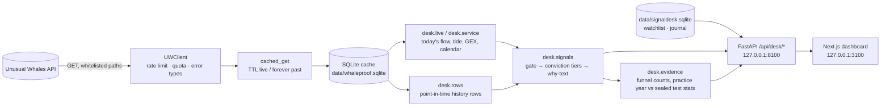

# WhaleProof — architecture

The WhaleProof dashboard turns the Unusual Whales options-flow firehose into a short list of
high-conviction signals, each with a plain-English "why this passed" line, and it shows how that filter performed in the
past. Every number on screen comes from the local cache or a live, budgeted UW call. Nothing is mocked.

## Layers

| Layer | Module | Owns | Never does |
|---|---|---|---|
| Access | `core/data_layer/client.py`, `fetch.py`, `store.py` | HTTP to UW, budget headers, cache | business logic |
| Ingest | `core/data_layer/ingest.py`, `desk/live.py` | turning UW payloads into cache rows / small typed dicts | scoring |
| Logic | `desk/signals.py`, `desk/evidence.py`, `desk/service.py`, `core/verdict/setups.py` | gate, tiers, why-text, funnel, stats | HTTP, UI |
| Config | `desk/config.py` | every threshold, TTL, port, budget reserve | — |
| User data | `desk/userdb.py` | watchlist, trade journal, backups (separate DB file) | touching the UW cache |
| API | `api/desk.py` (router in `api/app.py`) | JSON for the UI, freshness + budget metadata | calling UW directly |
| UI | `frontend/app/*` | display, filters, local state | calling UW (only `/api/desk/*`) |

## Data flow

1. **History (cache first).** The cache holds UW flow alerts (premium ≥ $100K), daily bars, GEX levels, dark pool
   levels, IV rank, realized vol, earnings and sector. `scripts/desk_build_rows.py` turns it into point-in-time rows
   (decision at session close + 15 min, entry next open, five-day hold) under `data/desk/`.
2. **Live.** `desk/live.py` pulls today's flow alerts, market tide, SPY/QQQ GEX, economic calendar and per-ticker context
   through `cached_get` with short TTLs (flow 60 s, tide 5 min, calendar 12 h). Past dates are cached forever. Each call
   passes the adaptive budget (`core/budget.py` + `desk/config.py` reserve); a quota 429 stops live refresh and the UI shows
   "quota reached, resets 20:00 ET".
3. **Logic.** The same `desk.signals.classify()` runs on history rows and live alerts, so the backtest measures exactly
   the filter the UI shows.
4. **UI.** Server components fetch `/api/desk/*`; each payload carries `as_of`, `source` (cache/live) and `stale` so the UI
   can say "data 12 min old" or "market closed".

## Key choices

| Choice | Why |
|---|---|
| FastAPI + SQLite + Next.js 15 / Tailwind 4 | simple, fast, and runs locally with nothing else to install |
| Separate `signaldesk.sqlite` for user data | the 13 GB cache schema never changes; user data is small and backed up by copy |
| One classifier for history and live | the backtest measures what the UI shows |
| Sealed test (2025-10-01 → 2026-05-29), untouched until it was run once | the recent months were already looked at; a clean sealed test beats a recent one |
| Stock five-day return vs the S&P 500 as the primary metric | long options lost money at normal fills in the practice year, so the stock move is the honest yardstick |
| 127.0.0.1 only, ports 8100/3100 | local-only by design: your key and your data stay on your machine |

## Market calendar
`whaleproof/market_calendar.py` (`exchange_calendars` XNYS): ET time, weekends, holidays, early closes. Every
"market open / closed / pre-market" label in the UI comes from `/api/desk/clock`.
